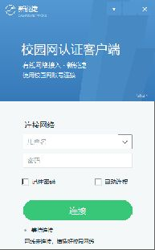

# Win-锐捷-MentoHust｜新锐捷

**一款小巧的 Windows 有线校园网客户端。打开、选择网卡、登录校园网。**

[下载 Windows 版](https://github.com/thekingofall/Win-Ruijie-MentoHust/releases/latest) · [使用方法](#开始使用) · [开机自动连接](#开机自启动) · [源码与许可](#来源与许可)

新锐捷采用经典锐捷的小窗口布局：蓝色顶部与窗口融为一体，紧凑的账号密码输入框、记住密码选项和绿色圆角连接按钮。右上角「▾」打开网络设置、连接日志和关于菜单，「−」最小化，「×」收起到托盘并保持联网；拖住蓝色顶部即可移动窗口。网卡选择放在网络设置中。登录后在主窗口查看连接状态和在线时长，也可以收起到系统托盘。

使用自己的校园网账号进行锐捷风格的 802.1X / EAP-MD5 认证。Wi-Fi、VPN、Hyper-V 和 WSL 虚拟网卡可以同时保留；认证与 DHCP 续租绑定到选定的物理以太网接口。



> 当前版本 0.6.0。Windows 界面、账号加密、网卡定位和模拟认证流程已完成离线检查。本机校园网登录与暂时关闭 Wi-Fi 后的有线访问已有实测记录。版本验证范围见 [测试说明](reports/release-validation.md)。长期稳定性及不同 VPN 配置仍需持续观察；学校的服务端策略和不同协议版本会影响结果。

## 开始使用

当前版本保留 Windows 原生窗口拖动与缓存背景。可运行 `dist/新锐捷-0.6.0.exe --preview` 打开离线预览，检查窗口拖动、菜单和最小化；预览中的连接和开机自启动设置停用。

从仓库的 Releases 页面下载 Windows 便携包，解压后打开 `新锐捷-0.6.0.exe`。也可以给它创建桌面快捷方式。启动时按 Windows 提示授予抓包驱动访问所需的管理员权限。程序使用本机现有 WinPcap 或 Npcap；本次开发已在已有 WinPcap 4.1 的机器上完成运行库识别。

插好校园网线，点击右上角「▾ → 网络设置」，在「有线网卡」中选择对应接口并点击「确定」。列表显示接口名称、插线状态和 MAC 尾号；「网卡信息」页显示完整型号、MAC、IP 和 GUID。首次使用需要手动选择，已失效的网卡标识需要刷新后重新选择。

填写校园网账号和密码，然后点击绿色「连接」按钮。请先在原版锐捷中正常断开并退出，再使用新锐捷连接，让当前账号由一个客户端维护。状态会依次显示寻找服务器、发送用户名、发送密码和在线保持。服务端确认成功后开始计时，按钮变为「断开连接」。

默认从本机锐捷安装目录读取 `8021x.exe`，供版本识别和客户端校验计算；可以在「网络设置 → 认证」中调整路径。下载包保留源码与许可说明，原版程序继续来自你本机已有安装。

## 多网卡与 VPN 如何共存

新锐捷发出的认证报文经过选定网卡。其他网卡上线或下线时，程序继续维持当前有线会话。Windows 的现有路由、VPN 分流、驱动和其他网卡配置由原有系统设置管理。

网络可用性还取决于学校认证服务器和 VPN 自身的路由配置。服务器返回失败时，日志会显示可解析的提示；连续失败达到上限后会停止重试。针对本校的实际兼容性，需要在插线环境中分别测试原版、新锐捷，以及 VPN 开启前后表现。

## 账号与设置

### 开机自启动

在「网络设置 → 常规」开启「开机自动联网（无需登录 Windows）」。软件先验证系统账户能够读取加密凭据、访问所选网卡，再启动后台连接。成功后电脑开机即可认证，登录 Windows 前也能运行。请保持网线连接，并保留本机原版客户端和抓包驱动。

后台模块随新锐捷打包。启用时将当前程序部署到系统应用数据目录，创建 SYSTEM 开机任务并配置每分钟恢复检查。账号密码采用机器范围 DPAPI 加密，后台目录仅 SYSTEM 和管理员可读写。更新账号或网络参数时，关闭此开关、修改设置，再重新开启。

主窗口显示后台连接状态；关闭窗口或退出托盘后，后台认证继续运行。关闭「开机自动联网」会结束后台连接并停用开机任务。连接失败会延迟重试，等待时间逐步增加到五分钟。启用失败会恢复此前的后台任务与配置。

「登录后显示新锐捷」控制登录 Windows 后打开界面。主窗口的「自动连接」用于普通前台连接；检测到开机后台任务时，界面会显示后台状态。界面预览中的系统开关停用。

### 登录信息

勾选「记住密码」后，前台配置中的密码由 Windows DPAPI 按当前 Windows 用户加密保存。换电脑或换 Windows 用户后需要重新输入。「导出设置」将账号、密码和自动连接清空，适合分享网络参数。日志中已知账号和密码会被隐藏。

前台配置与日志保存在 `%LOCALAPPDATA%/新锐捷/`。日志可能含本机地址和服务端文本，分享前请查看内容。

前台「自动连接」需要已保存密码和已插线的所选网卡。点击「×」、按 Alt+F4 或选择「收起到托盘」后，连接与心跳继续运行。右键通知区域的新锐捷图标，选择「显示主窗口」即可恢复。选择「退出」会注销前台连接；开机后台连接由设置中的开关控制。图标可能位于任务栏的隐藏图标区域（^）。

## 常见设置

| 设置 | 含义 |
| --- | --- |
| 客户端版本 | 当前本机参考客户端为 5.00；按照本机版本与网络要求填写 |
| 组播模式 | 0 标准 802.1X；1 锐捷组播（默认）；2 CERNET 兼容流程 |
| DHCP 0 | 使用所选网卡现有地址 |
| DHCP 1 | 首次认证成功后续租，再重新认证 |
| DHCP 2 | 认证成功后续租（默认） |
| DHCP 3 | 先续租，再认证 |
| IP / 掩码 / 网关 / DNS | `0.0.0.0` 表示从所选网卡读取 |
| 失败上限 | 默认 3 次；账号或服务器报错后可调整设置再重连 |

DHCP 使用选定 GUID 对应的 Windows 网卡配置实例进行续租。学校使用静态地址时请将 DHCP 设为 0，并按网络要求配置所选接口。

无线 PEAP/TLS、网页登录 Portal、学校专用安全组件属于其他认证路径。当前实现对应有线锐捷 / MentoHUST 的 MD5 流程。

## 源码、测试与打包

使用 Python 3.12，在项目内建立环境：

```powershell
python -m venv .venv
.\.venv\Scripts\python.exe -m pip install -e .\mentohust-modern[build]
.\.venv\Scripts\python.exe -m unittest discover -s mentohust-modern/tests -t mentohust-modern
.\.venv\Scripts\python.exe -m mentohust_modern
```

构建 Windows 单文件程序：

```powershell
pwsh -File mentohust-modern/tools/build_exe.ps1
```

打包产物在 `dist/`。构建中间文件默认使用 Windows 临时目录，可通过 `-WorkRoot` 改为其他目录。打包使用项目环境中的 PyInstaller。随后执行 `.\.venv\Scripts\python.exe mentohust-modern/tools/package_delivery.py`，生成对应源码包、依赖许可和 SHA-256 校验文件。程序可以在已有抓包驱动的 Windows 电脑上运行，无需另行安装 Python。

主要代码位于 `mentohust-modern/src/mentohust_modern/`：`client.py` 管理认证与心跳，`interfaces.py` 负责精确网卡定位和续租，`config.py` 与 `secrets.py` 管理账号设置，`gui.py` 提供中文窗口。离线用例在 `mentohust-modern/tests/`。

## 来源与许可

新锐捷基于 [MentoHUST Win Modern](https://github.com/huangli2006920-coder/mentohust-win-modern)，上游提交 `5a735af910a853210f30e23e4072e28a64cea856`。协议参考 [MentoHUST](https://github.com/HustLion/mentohust) 及 [OpenWrt 实现](https://github.com/KyleRicardo/MentoHUST-OpenWrt-ipk)。本项目沿用 [GPL-3.0](LICENSE)，版权和许可遵循各原作者声明。

本次修改加入新锐捷界面、多个网卡共存、严格网卡标识、定向续租、DPAPI 密码保存和协议边界检查。软件为独立兼容实现，与锐捷官方无隶属关系。分发修改版时请按 GPL 同步提供对应源码和许可证。
